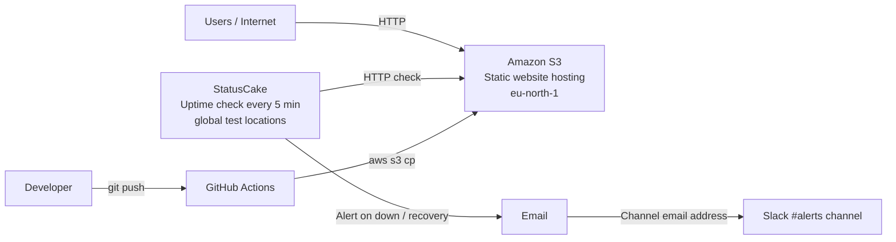

# AWS S3 Static Website with Uptime Monitoring and Slack Alerting

A small hands-on project where I host a static website on Amazon S3, monitor it externally with StatusCake, route alerts to a Slack channel, and test the whole alerting chain by simulating an outage.

**Live site:** http://sajid-portfolio-site007.s3-website.eu-north-1.amazonaws.com/

## Architecture

## What I built

- **Hosting:** An S3 bucket in `eu-north-1` (Stockholm) with static website hosting enabled, serving `index.html`.
- **Access control:** A bucket policy (`bucket-policy.json`) that allows public **read-only** access to objects in this bucket only.
- **Monitoring:** A StatusCake HTTP uptime test that checks the site from external locations and expects a `200 OK` response.
- **Alerting:** A StatusCake contact group that sends alerts by email, including to the Slack `#alerts` channel's email address, so the "team" sees incidents in one place.

## Testing the alerting (simulated outage)

Untested monitoring can fail silently when you need it most, so I tested the full chain:

1. Renamed `index.html` to `index-off.html` in S3. The site started returning **404 Not Found**.
2. StatusCake detected the failure ("Unexpected Status Code", from its Hong Kong test location) and posted an alert to Slack `#alerts`.
3. Renamed the file back. StatusCake confirmed recovery and sent a "test has recovered" alert.

| Metric                             | Result     |
| ---------------------------------- | ---------- |
| Time to detect                     | ~2 minutes |
| Downtime recorded by StatusCake    | 5 min 13 s |
| Actual outage (from rename to fix) | ~7 minutes |

The difference between recorded and actual downtime comes from the check interval: monitoring only counts downtime from when it notices the problem. Critical production systems would use a shorter interval (30–60 s).

**Downtime alert**

**Recovery alert**

## Automated deployment (CI/CD)

Every push to `master` triggers a GitHub Actions workflow (`.github/workflows/deploy.yml`) that:

1. Checks out the code on a fresh runner
2. Authenticates to AWS using credentials stored in GitHub Secrets
3. Deploys `index.html` to S3

The workflow uses a dedicated IAM user (`github-actions-deployer`) with a least-privilege policy: it can only list, upload and delete objects in this one bucket.
