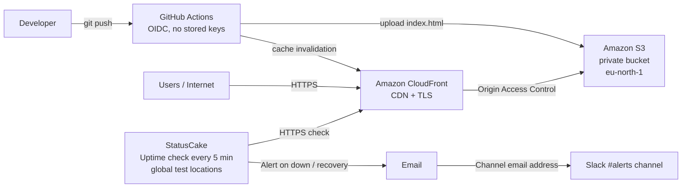
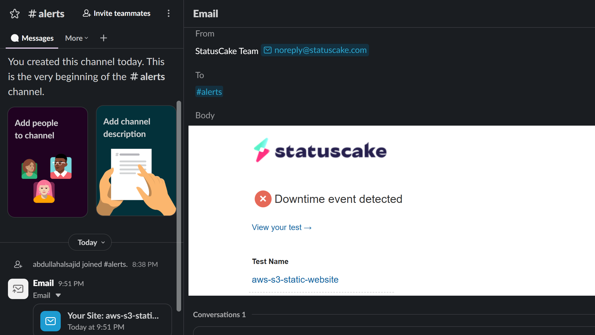
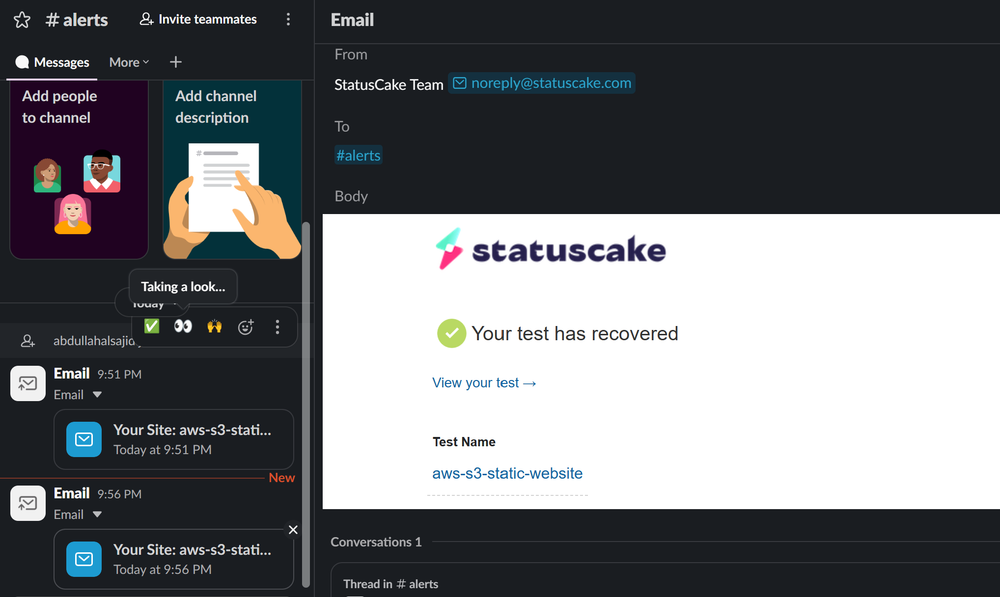

# Static Website on AWS (S3 + CloudFront) with CI/CD, Monitoring and Slack Alerting

A small hands-on project where I host a static website on a private Amazon S3 bucket served over HTTPS through CloudFront, deploy it automatically with GitHub Actions, monitor it externally with StatusCake, route alerts to a Slack channel, and test the alerting chain by simulating an outage.

**Live site:** https://d5f0uoxhzlj3z.cloudfront.net/index.html

## Architecture

## What I built

- **Hosting:** A private S3 bucket in `eu-north-1` (Stockholm) holds the site files. Block Public Access is enabled.
- **CDN and HTTPS:** Amazon CloudFront serves the site over HTTPS (HTTP is redirected to HTTPS) and caches content at edge locations close to visitors.
- **Access control:** Origin Access Control (OAC) with a bucket policy (`bucket-policy.json`) that allows only this CloudFront distribution to read objects. There is no direct public access to the bucket.
- **Monitoring:** A StatusCake HTTP uptime test that checks the CloudFront HTTPS URL from external locations and expects a `200 OK` response.
- **Alerting:** A StatusCake contact group that sends alerts by email, including to the Slack `#alerts` channel's email address, so the "team" sees incidents in one place.

## Testing the alerting (simulated outage)

Untested monitoring can fail silently when you need it most, so I tested the full chain. This test was done on the original S3 website endpoint, before CloudFront was added:

1. Renamed `index.html` to `index-off.html` in S3. The site started returning **404 Not Found**.
2. StatusCake detected the failure ("Unexpected Status Code", from its Hong Kong test location) and posted an alert to Slack `#alerts`.
3. Renamed the file back. StatusCake confirmed recovery and sent a "test has recovered" alert.

| Metric                             | Result     |
| ---------------------------------- | ---------- |
| Time to detect                     | ~2 minutes |
| Downtime recorded by StatusCake    | 5 min 13 s |
| Actual outage (from rename to fix) | ~7 minutes |

The difference between recorded and actual downtime comes from the check interval: monitoring only counts downtime from when it notices the problem. Critical production systems would use a shorter interval (30–60 s).

**Downtime alert**

**Recovery alert**

## Migrating to CloudFront without downtime

I moved from a public S3 website to a private bucket behind CloudFront in an order that kept the site available throughout:

1. Created the CloudFront distribution and added a bucket policy statement for it, **alongside** the existing public statement.
2. Verified the new HTTPS URL worked, including the HTTP-to-HTTPS redirect.
3. Pointed StatusCake at the CloudFront URL, so monitoring watched the new path before any risky change.
4. Only then locked the bucket: removed the public statement, re-enabled Block Public Access and disabled S3 static website hosting.
5. Verified that the CloudFront URL still worked and the old S3 URL was refused.

## Automated deployment (CI/CD)

Every push to `master` triggers a GitHub Actions workflow (`.github/workflows/deploy.yml`) that:

1. Checks out the code on a fresh runner
2. Authenticates to AWS using **OIDC**: GitHub issues a short-lived signed token, and AWS exchanges it for temporary credentials. No AWS keys are stored in GitHub.
3. Deploys `index.html` to S3
4. Invalidates the CloudFront cache (`/` and `/index.html`), so visitors get the new version immediately instead of a cached copy

The IAM role's trust policy only allows workflows from this repository on the `master` branch, identified by GitHub's immutable owner and repository IDs. The role's permissions are least-privilege: list, upload and delete objects in this one bucket, and create cache invalidations on this one distribution.

### Troubleshooting note

The first OIDC run failed with `Not authorized to perform sts:AssumeRoleWithWebIdentity`. I added a temporary debug step to print the token's claims and found that GitHub sends the subject with immutable IDs (`repo:owner@id/repo@id:ref:...`), while the trust policy used the name-only format. Updating the trust policy fixed it.
